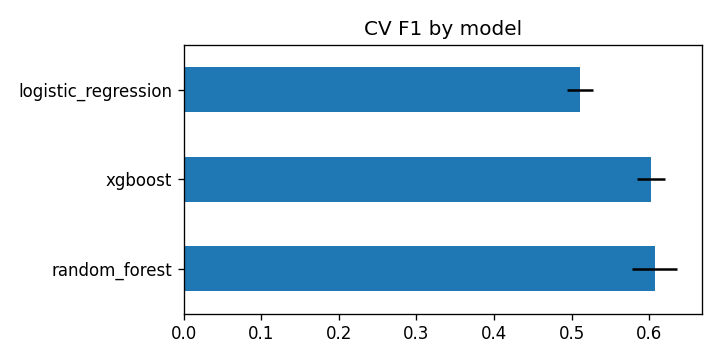
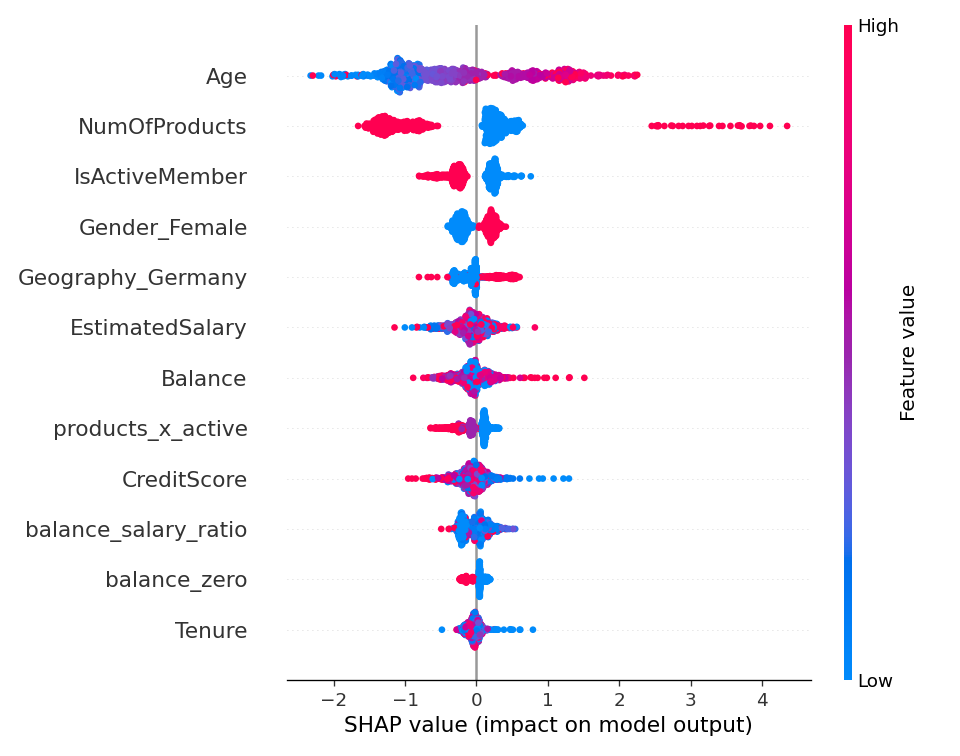
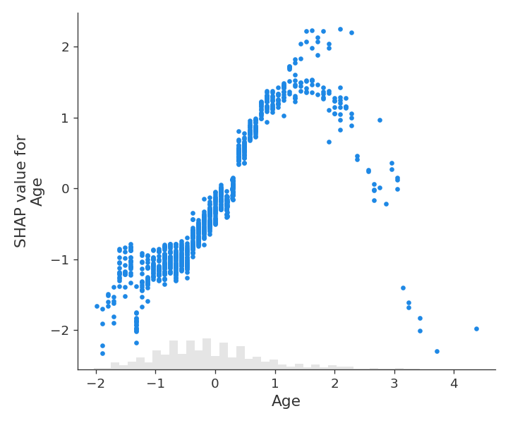

# Churn Prediction — Bank Customers

> **Résumé (FR)** — Prédiction du départ de clients bancaires (10 000 clients, 20,4 % de départs). Trois modèles comparés en validation croisée ; le Random Forest retenu atteint une AUC-ROC de 0,86 sur le jeu de test. SHAP et une analyse par segments montrent que l'âge (50-59 ans), le fait de ne détenir qu'un seul produit et l'inactivité concentrent les départs, d'où des recommandations de rétention ciblées.

## Problem
Identify customers likely to close their account so that retention teams can act before they leave.

## Data
[Bank Customer Churn](https://www.openml.org/d/45586) (OpenML 45586): 10,000 customers, churn rate **20.37 %**. Identifiers (`RowNumber`, `CustomerId`, `Surname`) are dropped before modelling.

## Approach
- **Engineered features**: zero-balance flag, balance / salary ratio, products × active member, age bands.
- **One pipeline per model**: feature engineering → one-hot encoding + scaling → estimator (no leakage between folds).
- **Model selection**: logistic regression, random forest and XGBoost compared with stratified 5-fold CV on F1; the best is evaluated once on the 2,000-customer test set.
- **Explainability**: SHAP (tree explainer) on XGBoost; dependence plots for the top 3 drivers.
- **Segments**: churn rate by Geography × age band × number of products, segments with ≥ 100 customers.

## Results

Cross-validation on the training set (8,000 customers):

| Model | F1 (mean ± std) | AUC |
|---|---|---|
| **Random forest** | **0.6075 ± 0.0290** | **0.8549** |
| XGBoost | 0.6025 ± 0.0176 | 0.8597 |
| Logistic regression | 0.5109 ± 0.0166 | 0.7839 |

Selected model: **random forest** — test set: **F1 0.6326, accuracy 0.8455, AUC-ROC 0.8636**, precision 0.6129, recall 0.6536.
(XGBoost on the same test set: F1 0.6095, AUC-ROC 0.8627, recall 0.7420.)

Top drivers (mean |SHAP|, XGBoost): `Age`, `NumOfProducts`, `IsActiveMember`, `Gender_Female`, `Geography_Germany`.





## High-risk segments

| Geography | Age band | Products | Customers | Churn rate | Lift |
|---|---|---|---|---|---|
| Germany | 50-59 | 1 | 184 | 77.7 % | 3.82 |
| France | 50-59 | 1 | 235 | 60.9 % | 2.99 |
| Germany | 40-49 | 1 | 404 | 57.7 % | 2.83 |
| Spain | 50-59 | 1 | 118 | 49.2 % | 2.41 |
| France | 40-49 | 1 | 661 | 34.3 % | 1.69 |

All five riskiest segments are **single-product customers aged 40-59**.

## Retention recommendations
- **Target single-product customers aged 40-59 first.** Every top-5 segment fits this profile, with churn rates of 34-78 % (lift 1.7 to 3.8). They are a small, well-defined audience for proactive contact.
- **Offer a second product to single-product customers.** Churn is 27.7 % with one product versus 7.6 % with two. This is a correlation, not proof of cause, so test it (see limitations).
- **Prioritise Germany.** German customers churn at 32.4 % against 16-17 % in France and Spain, and Germany holds the riskiest segment (50-59, one product: 77.7 %).
- **Re-engage inactive members.** Inactive customers churn at 26.9 % against 14.3 % for active ones, and `IsActiveMember` is a top-3 SHAP driver.
- **Treat 3-4 product holders as an alert, not a success.** They churn at 82.7 % (3 products, 266 customers) and 100 % (4 products, 60 customers), which suggests over-selling or unsuitable bundles worth investigating.

## Limitations & next steps
- Cross-sectional snapshot: no time dimension, so no survival / time-to-churn modelling.
- Recommendations are correlational; validate them with A/B tests before rollout.
- Decision threshold left at 0.5; a cost-based threshold (as in the [fraud project](https://github.com/elgr3/fraud-detection)) would match a retention budget better.

## How to run
```bash
python -m venv .venv
.venv/Scripts/activate          # Linux/macOS: source .venv/bin/activate
pip install -r requirements-dev.txt
python run.py                   # about a minute on CPU
pytest
```

## Project structure
```
src/churn_prediction/   config · data · features · models · explain · segments
notebooks/01-eda.ipynb  churn by geography, gender, products, activity, age
reports/                metrics.json, segments.csv, figures (generated by run.py)
tests/                  fast unit tests on synthetic data (run in CI)
run.py                  full pipeline
```
